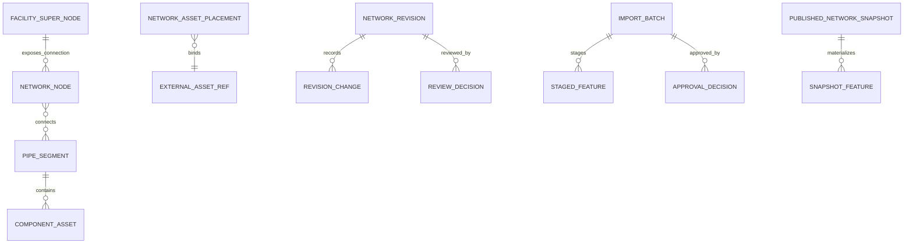
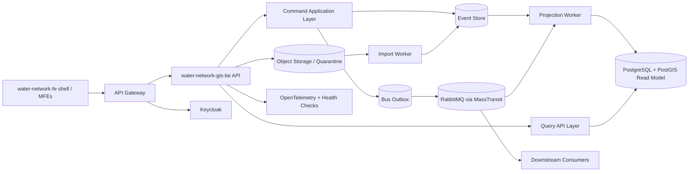
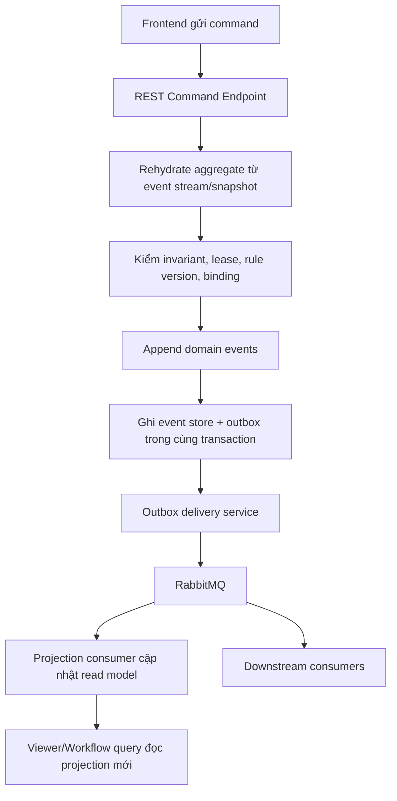
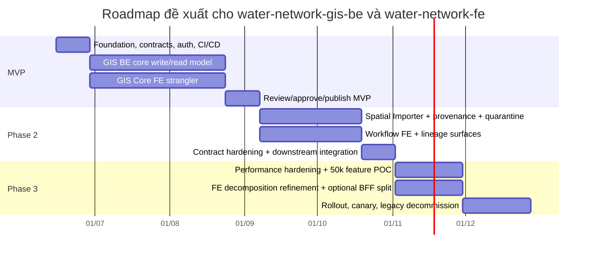

# Báo cáo phân tích và kế hoạch thực thi water-network-gis-be và lộ trình migrate water-network-gis-fe

## Executive summary

PRD của `water-network-gis-fe` cho thấy đây không phải một GIS CRUD thông thường, mà là một miniapp tạo và quản trị **baseline mạng cấp nước có topology, hierarchy, spatial binding, provenance và publish gate**. MVP bao gồm `Published Network Viewer`, `Network Digitization/Topology Editor`, `Spatial Importer`, `FacilitySuperNode`, `ComponentAsset`, `NetworkAssetPlacement`, cùng workflow chặt chẽ từ draft/staging đến review, approve và publish để sinh `PublishedNetworkSnapshot` dùng cho downstream như CMMS, RCA và các bài toán mạng về sau. fileciteturn0file1 fileciteturn0file2 fileciteturn0file6 fileciteturn0file9

Khuyến nghị kiến trúc thực thi phù hợp nhất cho giai đoạn đầu là **một core microservice `water-network-gis-be` sở hữu toàn bộ write-side domain** của GIS, đi kèm **các worker tách riêng theo runtime** cho projection, import và publish orchestration; chưa nên chia ngay thành nhiều backend microservices sở hữu dữ liệu riêng biệt. Lý do là integrity của published snapshot trong PRD phụ thuộc đồng thời vào topology, parent-child integrity, external binding, provenance, decision history và lifecycle gate; nếu tách quá sớm, chi phí consistency sẽ tăng mạnh. Microsoft cũng nhấn mạnh CQRS kết hợp Event Sourcing chỉ phù hợp khi lợi ích về auditability, historical reconstruction và materialized views đáng giá hơn độ phức tạp; đồng thời event-sourced systems nên dùng snapshot, optimistic concurrency và idempotent consumers để tránh drift và duplicate side effects. fileciteturn0file0 fileciteturn0file2 fileciteturn0file5 citeturn23view4turn23view1turn23view2

Ở ranh giới với frontend, nên dùng **RESTful API theo intent nghiệp vụ** cho các thao tác cần phản hồi UX tức thời như viewer, editor, validation, review queue; còn **event-driven** nên dùng cho projection, import processing, publish fan-out và tích hợp với microservice khác. Cách này bám đúng CQRS: command là business task, query trả DTO/read model tối ưu cho UI; đồng thời tránh dual-write giữa database và broker bằng Transactional Outbox/Consumer Outbox của MassTransit. citeturn2view0turn22view0turn26view0turn26view2turn13view0

Với frontend, chiến lược migrate phù hợp không phải “xé nhỏ” ngay `Viewer` và `Editor` thành hai micro-frontend độc lập, vì PRD đặt continuity của `Map Instance`, viewport, selection, layer/filter và active draft làm release gate. Cách an toàn hơn là giữ **`GIS Core` thành một MFE lớn trong MVP** để bảo toàn map runtime, còn `Importer` và `Workflow` là các candidate MFE tách sớm hơn; migration thực hiện theo **Strangler Fig** sau API Gateway, và chỉ thêm BFF khi payload hoặc cadence thực sự diverge. fileciteturn0file2 fileciteturn0file7 fileciteturn0file8 fileciteturn0file10 citeturn14view0turn14view1turn21view0

Bảng quyết định ngắn gọn để triển khai ngay:

| Quyết định | Khuyến nghị |
|---|---|
| Backend domain shape | Một core microservice `water-network-gis-be` + projection worker + import worker + publish worker |
| API style | REST cho UI-facing commands/queries; event-driven cho projections và integration |
| Write store | Ưu tiên reuse platform standard; nếu chưa có chuẩn, cân nhắc EventStoreDB hoặc PostgreSQL append-only streams |
| Read store | PostgreSQL + PostGIS + projection tables riêng cho viewer/editor/workflow |
| Message bus | MassTransit + RabbitMQ + Transactional Outbox |
| FE migration | `water-network-fe` shell + `GIS Core` MFE trước, sau đó `Importer` và `Workflow` |
| Auth | Keycloak OIDC/JWT validation ở API; không tự xây IAM |
| Audit | Không tự xây generic audit pipeline, nhưng **vẫn phải giữ domain decision history/lineage** trong GIS |

Các quyết định trên bám trực tiếp vào PRD FE và các pattern chính thức của Microsoft, MassTransit, Keycloak và Npgsql/PostGIS. fileciteturn0file0 fileciteturn0file1 fileciteturn0file2 fileciteturn0file5 citeturn8view1turn12view2turn12view3turn17view3turn26view3

## Bối cảnh sản phẩm và các giả định cần chốt

Phạm vi MVP trong PRD FE cho thấy GIS service này sở hữu **geometry, topology, relationship validation, spatial placement/binding và published network snapshot**, còn **asset master, maintenance lifecycle, work order và RCA/business outcome** thuộc Asset/CMMS service bên ngoài. Đây là boundary rất quan trọng, vì nó quyết định backend không nên mô hình hóa “lifecycle của tài sản” theo nghĩa CMMS, mà phải mô hình hóa **lifecycle của dữ liệu mạng**: revision, batch, decision và published snapshot. fileciteturn0file0 fileciteturn0file2 fileciteturn0file6

Ngoài ra, PRD FE yêu cầu rõ chỉ ba định dạng import trong MVP là `GeoJSON`, `KML`, `DXF`; có perimeter validation, quarantine/fail-safe, CRS normalization, provenance tối thiểu, retention decision history tối thiểu 1 năm, và publish gate chặn mọi topology/relationship/binding blocking error. Điều này làm cho `water-network-gis-be` phải có import pipeline, provenance store và publish governance từ đầu, thay vì coi import chỉ là một endpoint upload file đơn giản. fileciteturn0file0 fileciteturn0file2 fileciteturn0file5

PRD FE cũng đặt continuity của `Viewer <-> Editor` và khả năng duy trì `Map Instance`, viewport, layer/filter, selection, draft context làm tiêu chí kỹ thuật cốt lõi. Điều đó ảnh hưởng trực tiếp đến lộ trình migrate FE: nếu tách viewer và editor thành hai MFE độc lập quá sớm, gần như chắc chắn sẽ phá yêu cầu continuity này. Vì vậy, migration nên theo hướng tách theo **bounded UI surfaces ít phụ thuộc persistent map runtime** trước, thay vì tách theo menu hoặc theo CRUD screen. fileciteturn0file2 fileciteturn0file7 fileciteturn0file8 fileciteturn0file10

Những điểm dưới đây hiện **không xác định** hoặc cần chốt thêm trước khi code production:

| Hạng mục | Trạng thái | Ảnh hưởng kiến trúc |
|---|---|---|
| Canonical CRS của `PublishedNetworkSnapshot` | **không xác định** trong PRD FE | Phải đưa vào runtime config, không hardcode |
| Tên claim tenant trong token | **không xác định** | `tenant_id`, `org_id` hay realm-specific mapper cần chốt với IAM/platform |
| Danh mục asset master ngoài pilot catalog | **không xác định** ngoài catalog MVP | Chỉ cho phép binding theo allow-list hiện tại |
| Map engine/vendor cuối cùng | `ArcGIS` là tùy chọn, không bắt buộc | Thiết kế anti-corruption adapter, không gắn domain vào vendor |
| Data migration source của FE hiện tại | **không xác định** | Cần chốt FE hiện giữ local state, mock data hay đang gọi API thật |
| Advanced graph/isolation/history features | Không thuộc baseline MVP, chỉ là conditional | Không đưa vào critical path kiến trúc giai đoạn đầu |

Các điểm “không xác định” này không chặn việc thiết kế service, nhưng phải chuyển thành runtime config, feature flags hoặc ADR trước khi đóng specification chi tiết. fileciteturn0file2 fileciteturn0file6 fileciteturn0file7 fileciteturn0file10

Một điểm cần nói rõ: bạn yêu cầu không cần “xây audit log” vì microservice khác đã xử lý. Điều đó hợp lý với **generic operational audit** hoặc centralized audit pipeline. Tuy nhiên, PRD FE vẫn yêu cầu `ReviewDecision`, `ApprovalDecision`, `PublishRecord`, `ProvenanceRecord`, `ValidationEvidence` và lineage truy vết published snapshot. Những dữ liệu này là **business records của chính GIS domain**, không thể thay bằng access log hoặc request log của platform. Vì vậy, kế hoạch dưới đây giả định: **không xây audit subsystem riêng**, nhưng **vẫn phải lưu decision history/lineage trong domain model hoặc projection**. fileciteturn0file0 fileciteturn0file2 fileciteturn0file5 fileciteturn0file8

## Phân tích tính năng nghiệp vụ và bounded contexts

Tôi đề xuất mô hình hóa thành **năm bounded contexts logic bên trong một deployable backend service** ở giai đoạn MVP. Cách này giữ được ranh giới DDD rõ ràng mà chưa đẩy hệ thống sang chi phí distributed consistency quá sớm. Đồng thời, tôi **không đề xuất bounded context “Asset Maintenance Lifecycle”** trong GIS, vì PRD giao phần đó cho Asset/CMMS service; thứ GIS sở hữu là **data lifecycle của revision/import/snapshot**. fileciteturn0file0 fileciteturn0file2 fileciteturn0file6

### Ma trận bounded contexts, use cases và DDD building blocks

| Bounded context | Use cases cốt lõi | Entities chính | Value objects tiêu biểu | Aggregate roots khuyến nghị | Ghi chú |
|---|---|---|---|---|---|
| `Network Asset Management` | Tạo/sửa `PipeSegment`, `NetworkNode`, `FacilitySuperNode`, `ComponentAsset`; bulk edit thuộc tính kỹ thuật; gắn parent-child cho component; xóa/retire feature trong draft | `PipeSegment`, `NetworkNode`, `FacilitySuperNode`, `ComponentAsset`, `TopologyRelationship` | `FeatureId`, `FeatureKind`, `PipeClassification`, `DiameterMm`, `Material`, `FacilityType`, `ComponentType`, `ParentPipeReference` | `PipeSegmentAggregate`, `NetworkNodeAggregate`, `FacilityAggregate`, `ComponentAggregate` | Phần này chịu trách nhiệm cho catalog network feature pilot và technical attributes |
| `Spatial Topology and Validation Management` | Snap/split/connect; classify crossing; kiểm tra dangling endpoint, containment, connectivity size rule; lease/lock không gian; rule-version evidence | `SpatialEditLease`, `ValidationResult`, `ValidationEvidence`, `TopologyRelationship` | `GeometryVo`, `BoundingBox`, `CoordinateReferenceSystem`, `SnapTolerance`, `ContainmentRule`, `ConnectivitySizeRule`, `LeaseToken` | `NetworkRevisionAggregate`, `SpatialEditLeaseAggregate` | Validation là domain service mạnh, nhưng lease có aggregate riêng vì có lifecycle riêng |
| `External Asset Binding` | Tạo/sửa `NetworkAssetPlacement`; bind/unbind `externalAssetId` hoặc `assetRef`; verify binding; expose binding read-only cho viewer/downstream | `NetworkAssetPlacement`, `BindingVerificationRecord` | `ExternalAssetRef`, `AttachmentType`, `BindingStatus`, `AssetCatalogCode` | `AssetPlacementAggregate` | Không tạo master asset record, chỉ tham chiếu và spatial attachment |
| `Import Staging and Standardization` | Upload, perimeter validation, parse `GeoJSON/KML/DXF`, staging preview, mapping feature type, CRS normalization, provenance, quarantine | `ImportBatch`, `StagedFeature`, `ProvenanceRecord`, `ValidationResult` | `BatchId`, `FileDescriptor`, `Checksum`, `ParserVersion`, `SourceCRS`, `CanonicalCRS`, `ImportPolicySnapshot` | `ImportBatchAggregate` | Đây là long-running flow; nên dùng worker + state machine/saga mức ứng dụng |
| `Publication and Snapshot Governance` | Submit revision/batch, review, approve/reject, publish, tạo `PublishedNetworkSnapshot`, lineage, decision history | `NetworkRevision`, `ReviewDecision`, `ApprovalDecision`, `PublishRecord`, `PublishedNetworkSnapshot` | `RevisionId`, `SnapshotId`, `RevisionStatus`, `BatchStatus`, `DecisionReason`, `ValidationEvidenceRef`, `PublishedAtUtc` | `NetworkRevisionAggregate`, `ImportBatchAggregate`, `PublishedSnapshotAggregate` | Đây là “data lifecycle” của GIS, không phải maintenance lifecycle của asset |

Bảng trên được tổng hợp từ PRD FE, domain requirements, journeys và scope MVP. fileciteturn0file0 fileciteturn0file2 fileciteturn0file6 fileciteturn0file9

### Những use cases hiện chưa nên đưa vào MVP

| Use case | Trạng thái |
|---|---|
| Directional topology graph | **không xác định cho baseline MVP**, chỉ là conditional/post-scope gate |
| Isolation trace, upstream/downstream trace | **không xác định cho baseline MVP**, chỉ triển khai sau scope/API/ownership gate riêng |
| Pressure-zone boundary checks nâng cao | Conditional |
| Historical playback theo thời gian | Conditional |
| Maintenance workflow, work order, RCA outcome | Ngoài boundary của GIS |

Những mục này có trong backlog/traceability nhưng PRD nói rõ chưa thuộc baseline release. fileciteturn0file2 fileciteturn0file6 fileciteturn0file7

### Quan hệ aggregate ở mức khái niệm



Sơ đồ này phản ánh một nguyên tắc quan trọng: **feature aggregates và workflow aggregates phải tách nhau ở write-side**, nhưng `PublishedNetworkSnapshot` lại là projection/domain artifact tập hợp kết quả cuối cùng sau validation và publish. DDD cũng yêu cầu aggregate root chịu trách nhiệm giữ invariant; do đó các rule như component phải có `parentPipeSegmentId`, revision không được publish khi chưa `approved_pending_publish`, và lease hết hạn phải chặn mutation đều nên được giữ ở aggregate hoặc domain service liên quan, không đẩy hết xuống controller hay EF layer. citeturn3view1turn22view0

## Thiết kế kiến trúc

Khuyến nghị phù hợp nhất là **kiến trúc hybrid REST + event-driven trên nền CQRS/Event Sourcing**: REST ở boundary với UI, event-driven ở nội bộ service và với hệ sinh thái. CQRS chính thức khuyến nghị tách command và query vì read/write có nhu cầu scale, schema và security khác nhau; Event Sourcing cho phép append-only audit trail, replay để rebuild materialized views, nhưng đi kèm trade-off về concurrency, schema evolution và query complexity, nên phải giới hạn ở command side và dùng read projections riêng. citeturn2view0turn3view0turn23view4

### Kiến trúc runtime đề xuất



Kiến trúc này cố ý tách ba vai trò: **event store không phải message broker**, **read model không phải aggregate state**, và **import processing không chạy trên request thread**. Microsoft lưu ý rõ broker như Kafka/RabbitMQ không thay event store, còn read model trong CQRS nên là materialized view/durable cache tối ưu cho UI. MassTransit outbox giúp đồng bộ transactional boundary giữa `DbContext` và event bus mà không cần distributed transaction. citeturn23view4turn23view2turn26view2turn26view3

### Vì sao chọn REST ở ngoài và event-driven ở trong

| Mặt cắt | Khuyến nghị | Lý do |
|---|---|---|
| Viewer queries | REST `GET` | FE cần map-frame fetch, feature detail, related graph, lineage query có phản hồi tức thời |
| Editor actions nhẹ | REST `POST/PUT/DELETE` theo business intent | UX cần lỗi cụ thể ngay sau khi edit/snap/split/validate |
| Heavy import processing | REST để tạo job + async worker xử lý | Upload/file parse/CRS normalization/quarantine là tác vụ dài |
| Publish/projection/downstream integration | Event-driven | Tách write commit khỏi projection fan-out và service integration |
| Lock/lease change notification | Optional WebSocket/SignalR, nhưng backend vẫn authoritative | PRD nói rõ realtime lock event không phải source of truth |

Nguồn quyết định này đến từ chính PRD FE và CQRS guidance: command nên biểu diễn business task, query trả DTO/read model, còn asynchronous messaging phù hợp với eventual consistency giữa write/read stores và pub/sub giữa services. fileciteturn0file0 fileciteturn0file2 citeturn2view0turn23view3turn13view0

### Stores và deployment units đề xuất

| Thành phần | Khuyến nghị |
|---|---|
| Write-side event store | Reuse platform standard trước; nếu chưa có chuẩn, chọn **EventStoreDB** hoặc **PostgreSQL append-only streams** |
| Read-side store | PostgreSQL + PostGIS |
| File/quarantine store | S3-compatible/object storage hoặc platform file service |
| Broker | RabbitMQ thông qua MassTransit |
| API runtime | ASP.NET Core trên .NET 10 |
| Background workers | `ProjectionWorker`, `ImportWorker`, `PublishWorker` |
| Cross-cutting telemetry | OpenTelemetry + centralized logging/metrics/traces |
| Liveness/readiness | ASP.NET Core health checks |

Về event store, Microsoft chỉ ra purpose-built event stores có built-in support cho per-entity stream reads, optimistic concurrency và snapshots, còn relational databases quen thuộc hơn nhưng bạn phải tự xây các hành vi đó. Vì project này chắc chắn cần PostGIS cho query side, lựa chọn thực dụng nhất là: **nếu platform đã chuẩn hóa EventStoreDB thì reuse; nếu chưa, dùng PostgreSQL append-only write schema + PostGIS read schema để giảm vận hành**. citeturn23view4turn12view2turn12view3turn19view1

### Commands cần xử lý

| Nhóm command | Commands tiêu biểu | Aggregate chính |
|---|---|---|
| Revision authoring | `CreateRevision`, `RenameRevision`, `SaveDraftMetadata` | `NetworkRevisionAggregate` |
| Feature authoring | `CreatePipeSegment`, `UpdatePipeSegmentGeometry`, `UpdatePipeSegmentAttributes`, `CreateNetworkNode`, `CreateFacilitySuperNode`, `CreateComponentAsset`, `RemoveDraftFeature` | Feature aggregates |
| Topology editing | `SnapEndpoint`, `SplitPipeSegment`, `ConnectNodeToSegment`, `ClassifyCrossing`, `ApplyBulkAttributes` | Feature aggregates + `NetworkRevisionAggregate` |
| Spatial binding | `CreateAssetPlacement`, `BindExternalAsset`, `UnbindExternalAsset`, `VerifyBinding` | `AssetPlacementAggregate` |
| Lease/validation | `AcquireSpatialEditLease`, `RenewSpatialEditLease`, `ReleaseSpatialEditLease`, `RunDraftValidation` | `SpatialEditLeaseAggregate`, `NetworkRevisionAggregate` |
| Import pipeline | `CreateImportBatch`, `UploadImportSource`, `StartParsing`, `MapStagedFeature`, `NormalizeCRS`, `ValidateImportBatch`, `QuarantineImportBatch` | `ImportBatchAggregate` |
| Workflow | `SubmitRevisionForReview`, `RecordRevisionReview`, `ApproveRevision`, `RejectRevision`, `SubmitBatchForReview`, `RecordBatchReview`, `ApproveBatch`, `RejectBatch` | `NetworkRevisionAggregate`, `ImportBatchAggregate` |
| Publish | `PublishApprovedRevision`, `PublishApprovedBatch`, `SupersedeSnapshot` | `PublishedSnapshotAggregate` |

Các command ở đây nên được mô hình hóa theo **business intent** thay vì kiểu CRUD thuần như “set status = approved”, vì CQRS nhấn mạnh command nên phản ánh tác vụ nghiệp vụ thực sự. citeturn2view0

### Events cần phát hành

| Event | Loại | Khi phát sinh | Consumer chính |
|---|---|---|---|
| `RevisionCreatedV1` | Domain/Internal | Tạo revision mới | Projection worker, workflow read model |
| `PipeSegmentDraftedV1` | Domain/Internal | Tạo/sửa pipe segment trong draft | Validation projection |
| `ComponentParentAssignedV1` | Domain/Internal | Gắn component với pipe | Validation projection |
| `ExternalAssetBoundV1` | Domain/Internal hoặc Integration nội bộ | Gắn `externalAssetId/assetRef` | Binding projection, optional audit sink |
| `DraftValidationCompletedV1` | Domain/Internal | Kết thúc validation | Review queue read model |
| `RevisionSubmittedForReviewV1` | Domain/Internal | Submit revision | Workflow UI |
| `RevisionApprovedPendingPublishV1` | Domain/Internal | Approve revision | Publish worker |
| `RevisionRejectedV1` | Domain/Internal | Reject revision | Workflow UI |
| `ImportBatchUploadedV1` | Domain/Internal | Upload hoàn tất | Import worker |
| `ImportBatchQuarantinedV1` | Integration nội bộ | Vi phạm perimeter/policy | Ops dashboard/support |
| `ImportBatchReadyForReviewV1` | Domain/Internal | Batch đủ điều kiện review | Workflow UI |
| `NetworkSnapshotPublishedV1` | **Integration event chính** | Published snapshot mới | CMMS/reference consumers, analytics, cache invalidation |
| `PublishedSnapshotSupersededV1` | Integration event | Snapshot active thay đổi | Downstream re-sync |
| `AssetSpatialBindingPublishedV1` | Integration event | Binding published thay đổi | Asset/CMMS read-side consumers |

Một rule quan trọng: **domain events** xử lý side effects trong cùng bounded context/process; còn **integration events** chỉ được phát sau khi transaction domain đã commit thành công. Đây là phân biệt rất quan trọng trong .NET microservices guidance. citeturn22view0turn13view0

### Queries cần trả về

| Query | Mục đích |
|---|---|
| `GetCurrentPublishedSnapshotQuery` | Lấy snapshot active cho viewer |
| `GetSnapshotMapFrameQuery` | Trả feature theo `bbox`, `layers`, `filters`, `snapshotId` |
| `SearchPublishedFeaturesQuery` | Search theo identifier, type, external ref |
| `GetPublishedFeatureDetailQuery` | Detail panel, lineage strip, binding metadata |
| `GetRelatedFeaturesQuery` | 1-hop graph traversal cho tab “Liên quan” |
| `GetRevisionDetailQuery` | Xem draft, issues, save state |
| `GetValidationEvidenceQuery` | Hiển thị blocking/non-blocking evidence |
| `GetReviewQueueQuery` | Queue cho reviewer |
| `GetApprovalQueueQuery` | Queue cho approver/publisher |
| `GetImportBatchDetailQuery` | Chi tiết batch, staging, provenance, parser/version |
| `GetDecisionHistoryQuery` | Review/approve/reject/publish records |
| `GetAuditLineageQuery` | Chuỗi lineage của feature, revision, batch, snapshot |

Những query này nên đi vào **projection tables chuyên biệt** chứ không rehydrate event streams cho từng request viewer, vì Microsoft khuyến nghị read model ở CQRS là materialized view tối ưu cho presentation layer. citeturn2view0turn23view2

### Luồng sự kiện chuẩn



Đây là chỗ Transactional Outbox rất có giá trị: MassTransit ghi message vào database trong cùng scope với `DbContext`, sau đó delivery service đẩy message ra broker theo thứ tự; Consumer Outbox dùng inbox/outbox để đảm bảo exactly-once consumer behavior ở phía consumer. citeturn26view2turn26view3turn26view1

## Thiết kế API và dữ liệu

API nên dùng prefix version hóa rõ ràng, ví dụ ` /api/water-network-gis/v1 `. Với CQRS, tôi không khuyến nghị ép tất cả vào CRUD thuần, mà nên dùng **resource-based REST kết hợp sub-resource action endpoints** cho các command mang nghĩa nghiệp vụ như `/submit`, `/approve`, `/publish`, `/split`, `/classify-crossing`. Cách này vẫn REST-friendly nhưng phản ánh đúng domain task. citeturn2view0

### Các endpoint query cho Published Viewer và Evidence Surface

| Method | Endpoint | Mục đích | Role |
|---|---|---|---|
| `GET` | `/api/water-network-gis/v1/snapshots/current` | Lấy active published snapshot | `Viewer` |
| `GET` | `/api/water-network-gis/v1/snapshots/{snapshotId}` | Lấy metadata snapshot, validation outcome, publish info | `Viewer` |
| `GET` | `/api/water-network-gis/v1/snapshots/{snapshotId}/map-features?bbox=...&layers=...&filters=...` | Query map frame cho viewer/editor | `Viewer`,`Editor` |
| `GET` | `/api/water-network-gis/v1/snapshots/{snapshotId}/features/{featureId}` | Detail panel của feature/relationship | `Viewer` |
| `GET` | `/api/water-network-gis/v1/snapshots/{snapshotId}/features/{featureId}/related` | 1-hop related graph | `Viewer` |
| `GET` | `/api/water-network-gis/v1/snapshots/{snapshotId}/features/search?q=...` | Search theo id/type/external ref | `Viewer` |
| `GET` | `/api/water-network-gis/v1/snapshots/{snapshotId}/features/{featureId}/lineage` | Lineage strip, publish actor/time, validation outcome | `Viewer` |
| `GET` | `/api/water-network-gis/v1/lineage/{objectType}/{objectId}` | Decision/history chain cho feature, revision, batch hoặc snapshot | `Viewer`,`Review`,`Approve`,`Publish` |

Các endpoint này bám trực tiếp các FR của viewer, lineage strip, related tab và detail surface trong PRD FE. fileciteturn0file2 fileciteturn0file9

### Các endpoint command cho GIS Core Editor

| Method | Endpoint | Mục đích | Role |
|---|---|---|---|
| `POST` | `/api/water-network-gis/v1/revisions` | Tạo revision mới | `Editor` |
| `GET` | `/api/water-network-gis/v1/revisions/{revisionId}` | Lấy trạng thái draft hiện tại | `Editor` |
| `POST` | `/api/water-network-gis/v1/revisions/{revisionId}/pipes` | Tạo `PipeSegment` | `Editor` |
| `PUT` | `/api/water-network-gis/v1/revisions/{revisionId}/pipes/{pipeId}/geometry` | Cập nhật geometry pipe | `Editor` |
| `PUT` | `/api/water-network-gis/v1/revisions/{revisionId}/pipes/{pipeId}/attributes` | Cập nhật technical attributes | `Editor` |
| `POST` | `/api/water-network-gis/v1/revisions/{revisionId}/nodes` | Tạo `NetworkNode` | `Editor` |
| `POST` | `/api/water-network-gis/v1/revisions/{revisionId}/facilities` | Tạo `FacilitySuperNode` | `Editor` |
| `POST` | `/api/water-network-gis/v1/revisions/{revisionId}/components` | Tạo `ComponentAsset` | `Editor` |
| `PUT` | `/api/water-network-gis/v1/revisions/{revisionId}/components/{componentId}/parent` | Gắn `parentPipeSegmentId` | `Editor` |
| `POST` | `/api/water-network-gis/v1/revisions/{revisionId}/placements` | Tạo `NetworkAssetPlacement` | `Editor` |
| `PUT` | `/api/water-network-gis/v1/revisions/{revisionId}/placements/{placementId}/binding` | Bind `externalAssetId/assetRef` | `Editor` |
| `POST` | `/api/water-network-gis/v1/revisions/{revisionId}/topology/snap` | Snap endpoint/vertex | `Editor` |
| `POST` | `/api/water-network-gis/v1/revisions/{revisionId}/topology/split` | Split pipe | `Editor` |
| `POST` | `/api/water-network-gis/v1/revisions/{revisionId}/topology/classify-crossing` | Phân loại crossing vs connection | `Editor` |
| `POST` | `/api/water-network-gis/v1/revisions/{revisionId}/bulk-attributes` | Bulk update thuộc tính draft | `Editor` |
| `DELETE` | `/api/water-network-gis/v1/revisions/{revisionId}/features/{featureId}` | Xóa/retire trong draft | `Editor` |
| `POST` | `/api/water-network-gis/v1/revisions/{revisionId}/validate` | Chạy validation authoritative | `Editor` |
| `POST` | `/api/water-network-gis/v1/revisions/{revisionId}/submit` | Submit revision for review | `Editor` |

Lưu ý: `DELETE` ở đây phải hiểu là **draft removal/retire command**, không phải hard delete record, vì event-sourced write model về bản chất là append-only. citeturn3view0turn23view4

### Các endpoint cho lease, conflict và validation evidence

| Method | Endpoint | Mục đích | Role |
|---|---|---|---|
| `POST` | `/api/water-network-gis/v1/leases` | Acquire spatial edit lease | `Editor` |
| `PUT` | `/api/water-network-gis/v1/leases/{leaseId}/renew` | Gia hạn lease | `Editor` |
| `DELETE` | `/api/water-network-gis/v1/leases/{leaseId}` | Release lease | `Editor` |
| `GET` | `/api/water-network-gis/v1/revisions/{revisionId}/validation-evidence` | Xem evidence/rule version/CRS/binding state | `Editor`,`Review`,`Approve` |

PRD FE nói rõ lease là backend-authoritative; UI có thể nhận realtime lock update nhưng đó không phải source of truth. fileciteturn0file0 fileciteturn0file2

### Các endpoint cho Spatial Importer

| Method | Endpoint | Mục đích | Role |
|---|---|---|---|
| `POST` | `/api/water-network-gis/v1/import-batches` | Tạo batch upload mới; trả `202 Accepted` nếu parse async | `Importer` |
| `GET` | `/api/water-network-gis/v1/import-batches/{batchId}` | Trạng thái batch | `Importer` |
| `GET` | `/api/water-network-gis/v1/import-batches/{batchId}/staged-features` | Xem staging preview | `Importer` |
| `PUT` | `/api/water-network-gis/v1/import-batches/{batchId}/mappings/{stagedFeatureId}` | Map feature import vào catalog MVP | `Importer` |
| `POST` | `/api/water-network-gis/v1/import-batches/{batchId}/validate` | Chạy validate authoritative | `Importer` |
| `POST` | `/api/water-network-gis/v1/import-batches/{batchId}/submit` | Chuyển batch sang review flow | `Importer` |
| `GET` | `/api/water-network-gis/v1/import-batches/{batchId}/provenance` | Xem file metadata, checksum, CRS, parser version | `Importer`,`Review` |

Các endpoint này phản ánh đúng workflow import của PRD: allow-list, actual file-type check, quarantine/fail-safe, staging preview, mapping, validation, provenance và submit. fileciteturn0file0 fileciteturn0file2 fileciteturn0file9

### Các endpoint cho review, approve và publish

| Method | Endpoint | Mục đích | Role |
|---|---|---|---|
| `GET` | `/api/water-network-gis/v1/workflow/review-queue` | Queue các work item chờ review | `Review` |
| `GET` | `/api/water-network-gis/v1/workflow/approval-queue` | Queue chờ approve/publish | `Approve`,`Publish` |
| `GET` | `/api/water-network-gis/v1/workflow/items/{workItemId}` | Detail diff, evidence, provenance, decision history | `Review`,`Approve`,`Publish` |
| `POST` | `/api/water-network-gis/v1/revisions/{revisionId}/review` | Ghi review outcome | `Review` |
| `POST` | `/api/water-network-gis/v1/revisions/{revisionId}/approve` | Approve revision | `Approve` |
| `POST` | `/api/water-network-gis/v1/revisions/{revisionId}/reject` | Reject revision | `Approve` |
| `POST` | `/api/water-network-gis/v1/revisions/{revisionId}/publish` | Publish revision approved | `Publish` |
| `POST` | `/api/water-network-gis/v1/import-batches/{batchId}/review` | Review batch | `Review` |
| `POST` | `/api/water-network-gis/v1/import-batches/{batchId}/approve` | Approve batch | `Approve` |
| `POST` | `/api/water-network-gis/v1/import-batches/{batchId}/reject` | Reject batch | `Approve` |
| `POST` | `/api/water-network-gis/v1/import-batches/{batchId}/publish` | Publish batch approved | `Publish` |

Nhóm endpoint này phải gắn với state model PRD đã chốt; không được cho phép đường tắt từ draft/staging sang published. fileciteturn0file0 fileciteturn0file2 fileciteturn0file8

### DTOs, Commands và Events mẫu

Ví dụ command cho pipe segment:

```json
{
  "revisionId": "rev_01JY8XK4FC9W9S7SP0W8M9Q1Y2",
  "featureId": "pipe_01JY8XQJ8Q5G8R4D82ZWQ5P5QH",
  "geometry": {
    "type": "LineString",
    "coordinates": [
      [106.7001, 10.7769],
      [106.7014, 10.7775]
    ]
  },
  "srid": 4326,
  "classification": "distribution-main",
  "diameterMm": 150,
  "material": "PVC",
  "startNodeId": "node_01JY8XRQ5B6QCKNEMW8Q4ZJ6Q1",
  "endNodeId": "node_01JY8XSN1EKETQE5J5S45AHKSP",
  "leaseId": "lease_01JY8XTJ9R8T0C7J0W5R8H0P3A",
  "expectedStreamVersion": 12,
  "correlationId": "01JY8XV4N8ZKTF8J8HXP5F4S90"
}
```

Ví dụ DTO cho feature published:

```json
{
  "snapshotId": "snap_01JY8YA4W7FQX6S2P6P5C2Q9M1",
  "featureId": "pipe_01JY8XQJ8Q5G8R4D82ZWQ5P5QH",
  "featureKind": "PipeSegment",
  "geometry": {
    "type": "LineString",
    "coordinates": [[106.7001, 10.7769], [106.7014, 10.7775]]
  },
  "srid": 4326,
  "attributes": {
    "classification": "distribution-main",
    "diameterMm": 150,
    "material": "PVC"
  },
  "topologyStatus": "passed",
  "lineage": {
    "publishedAtUtc": "2026-09-14T08:20:00Z",
    "publishedBy": "u_12345",
    "publishRecordRef": "pub_01JY8Y..."
  },
  "binding": null
}
```

Ví dụ integration event trọng yếu nhất:

```json
{
  "eventType": "NetworkSnapshotPublishedV1",
  "schemaVersion": 1,
  "messageId": "01JY8Z7H9TBR1GYZXZQPS12V8Y",
  "correlationId": "01JY8XV4N8ZKTF8J8HXP5F4S90",
  "causationId": "cmd_publish_01JY8Z6Q...",
  "occurredAtUtc": "2026-09-14T08:20:00Z",
  "tenantId": "tenant_001",
  "snapshotId": "snap_01JY8YA4W7FQX6S2P6P5C2Q9M1",
  "sourceType": "Revision",
  "sourceId": "rev_01JY8XK4FC9W9S7SP0W8M9Q1Y2",
  "validationOutcome": "passed",
  "featureCounts": {
    "pipeSegments": 12453,
    "nodes": 13090,
    "facilities": 42,
    "components": 921
  }
}
```

Các payload nên có `messageId`, `correlationId`, `schemaVersion`, `occurredAtUtc`; với event schema, ưu tiên thay đổi backward-compatible bằng cách thêm field optional, còn breaking changes thì dùng version/topic mới. Pub/sub guidance của Microsoft cũng khuyến nghị correlation ID trong mọi message để nối trace end-to-end. citeturn13view0turn22view0

### Xử lý xác thực Keycloak, RBAC và user context

Keycloak hỗ trợ OIDC đầy đủ và cung cấp `/.well-known/openid-configuration` để client/API lấy metadata và endpoints như token, certs/JWKS, userinfo, introspection. Trong ASP.NET Core, API nên dùng `AddJwtBearer`, validate đầy đủ **signature**, **issuer**, **audience** và **expiration**; Microsoft nêu rõ nếu các claim như `iss` hoặc `aud` sai thì API phải trả `401`. `MapInboundClaims = false` là nên dùng để giữ nguyên claim names từ Keycloak thay vì để framework đổi tên. citeturn4view0turn17view3turn17view1

Keycloak mặc định đặt **realm roles** vào claim `realm_access.roles` và **client roles** vào `resource_access.{client}.roles`. Vì vậy, `water-network-gis-be` nên map policy theo capability: `Viewer`, `Editor`, `Importer`, `Review`, `Approve`, `Publish`. Ví dụ: policy `GIS.Editor` kiểm tra `realm_access.roles` chứa `gis-editor` hoặc `resource_access["water-network-fe"].roles` chứa `editor`. citeturn15view0turn15view1turn15view4

Với machine-to-machine, Keycloak sử dụng **Client Credentials Grant** dựa trên service account của client; đây là cách phù hợp cho BFF, projection workers hoặc job runners nếu chúng cần gọi service khác bằng token riêng của ứng dụng thay vì danh tính người dùng. citeturn16view2turn4view0

User context nên được chuẩn hóa thành một `IUserContext` hoặc `ExecutionContext` trong application layer, với bộ field tối thiểu sau:

| Field nội bộ | Claim/token source |
|---|---|
| `UserId` | `sub` |
| `UserName` | `preferred_username` hoặc fallback `sub` |
| `Email` | `email` nếu có |
| `ClientId` | `client_id` hoặc `azp` |
| `Roles` | `realm_access.roles` + `resource_access.*.roles` |
| `TenantId` | **không xác định** trong PRD; cần custom protocol mapper như `tenant_id` hoặc `org_id` |

Vì PRD FE không định nghĩa rõ multi-tenancy, tên claim tenant phải xem là assumption cần chốt với IAM/platform. fileciteturn0file10 citeturn15view0turn15view1

## Cấu trúc project và best practices

`.NET 10` hiện là bản **LTS**, được hỗ trợ đến tháng 11 năm 2028. Đây là lựa chọn phù hợp cho một domain service cần vòng đời bảo trì dài, và .NET 10 cũng tiếp tục hỗ trợ ASP.NET Core, EF Core và container publishing trên SDK hiện đại. citeturn8view0turn8view1

### Cấu trúc project đề xuất theo DDD/CQRS

```text
src/
  WaterNetwork.Gis.Api/
    Controllers/
    Endpoints/
    Filters/
    Authorization/
    Contracts/
    Program.cs

  WaterNetwork.Gis.Application/
    Abstractions/
    Commands/
      Revisions/
      Features/
      Imports/
      Workflow/
      Leases/
    Queries/
      Snapshots/
      Features/
      Workflow/
      Imports/
      Lineage/
    Behaviors/
      Validation/
      Transactions/
      Idempotency/
    DomainEventHandlers/
    IntegrationEventHandlers/

  WaterNetwork.Gis.Domain/
    NetworkAssets/
    Spatial/
    ExternalBindings/
    Imports/
    Publication/
    Common/
    SeedWork/

  WaterNetwork.Gis.Infrastructure/
    Persistence/
      EventStore/
      ReadModels/
      Migrations/
      Snapshots/
    Messaging/
      MassTransit/
      Outbox/
    Files/
      ObjectStorage/
      Quarantine/
    Security/
      Jwt/
      UserContext/
    Telemetry/
      Logging/
      Tracing/
      Metrics/
      HealthChecks/

  WaterNetwork.Gis.Workers/
    ProjectionWorker/
    ImportWorker/
    PublishWorker/

  WaterNetwork.Gis.Contracts/
    Commands/
    Events/
    Dtos/

tests/
  WaterNetwork.Gis.Domain.UnitTests/
  WaterNetwork.Gis.Application.UnitTests/
  WaterNetwork.Gis.Infrastructure.IntegrationTests/
  WaterNetwork.Gis.ContractTests/
  WaterNetwork.Gis.Api.IntegrationTests/
  WaterNetwork.Gis.E2ETests/
```

Nếu framework backend hiện có sẵn seedwork DDD/CQRS/Event Sourcing, nên **reuse naming/conventions hiện hữu**, không tạo song song một command bus hoặc entity base class khác. Cấu trúc trên là logical shape, không phải mệnh lệnh phải tạo đủ mọi project ngay ngày đầu. citeturn22view2turn22view0

### Dependencies .NET 10 nên có

| Nhóm | Package/Technology | Vai trò |
|---|---|---|
| Web/API | ASP.NET Core 10, `Microsoft.AspNetCore.Authentication.JwtBearer` | REST API, JWT validation, policy auth |
| Persistence | EF Core 10 | Read model, outbox tables, workflow/query projections |
| PostgreSQL Spatial | `Npgsql.EntityFrameworkCore.PostgreSQL`, `Npgsql.EntityFrameworkCore.PostgreSQL.NetTopologySuite`, `NetTopologySuite` | Postgres/PostGIS + spatial types |
| Messaging | `MassTransit`, `MassTransit.RabbitMQ`, `RabbitMQ` broker | Event bus, consumer orchestration |
| Validation | `FluentValidation` | Request/command validation ở application layer |
| Mapping | `AutoMapper` hoặc mapper platform-standard | DTO mapping ở edge/projection layer |
| Mediator | `MediatR` **nếu** framework chưa có dispatcher sẵn | In-process command/query/domain-event dispatch |
| Event store | `EventStoreDB.Client` **hoặc** write schema PostgreSQL append-only | Event streams |
| Observability | OpenTelemetry packages + exporter OTLP | Traces, metrics, logs |
| Logging | `Serilog.AspNetCore` hoặc logging stack platform-standard | Structured logs |
| Health | ASP.NET Core Health Checks | `/healthz`, `/readyz` |
| Time/ID | `NodaTime` hoặc equivalent | Time consistency, domain timestamps |

Spatial data trong EF Core dùng NetTopologySuite; Npgsql cấu hình `UseNetTopologySuite()` ở EF và ADO.NET layer, còn read-side query nên tận dụng PostGIS thay vì tự tính nhiều phép đo hình học ở client. citeturn12view2turn12view3turn25view1

### Ma trận chọn event store

| Tiêu chí | EventStoreDB | PostgreSQL append-only streams |
|---|---|---|
| Per-stream read/query theo entity | Tốt hơn, built-in | Tự xây |
| Optimistic concurrency | Built-in hơn | Tự xây qua expected version |
| Snapshots | Thuận tiện hơn | Tự quản lý bảng snapshot |
| Vận hành hạ tầng | Thêm 1 loại store mới | Đơn giản nếu đã có Postgres/PostGIS |
| Fit với GIS query side | Vẫn cần PostGIS riêng cho read model | Tận dụng cùng nền Postgres, nhưng tách schema rõ |

Theo Microsoft, purpose-built event stores hỗ trợ tốt hơn cho per-entity streams, optimistic concurrency và snapshots; còn relational stores đòi hỏi đội phát triển tự hiện thực các hành vi này. Vì service GIS chắc chắn đã cần PostgreSQL + PostGIS cho query side, lựa chọn thực tiễn thường là **ưu tiên platform standard**; nếu platform chưa chuẩn hóa EventStoreDB thì triển khai append-only streams trong PostgreSQL là phương án hợp lý cho MVP. citeturn23view4

### Best practices cốt lõi cho Event Sourcing, CQRS và microservices

| Chủ đề | Khuyến nghị |
|---|---|
| Aggregate invariants | Đặt trong constructor/method của aggregate root; không trông chờ DataAnnotations để giữ domain invariants |
| Domain events | Raise theo deferred pattern; dispatch ở application layer trước/sau commit tùy consistency boundary |
| Integration events | Chỉ phát sau khi aggregate commit thành công |
| Outbox/Inbox | Dùng Bus Outbox ở API scope; Consumer Outbox ở projection/downstream consumers |
| Snapshotting | Snapshot kỹ thuật cho aggregate mỗi N events hoặc ở các mốc lớn như publish; snapshot chỉ là optimization, không thay event stream |
| Optimistic concurrency | Mọi command write-side phải mang `expectedStreamVersion` hoặc ETag tương đương |
| Idempotency | Projection consumers lưu last processed event/message; event handlers phải an toàn khi xử lý duplicate |
| Sagas | Chỉ dùng cho long-running cross-boundary flows như import parsing/validation/publish orchestration; không lạm dụng trong nội bộ aggregate |
| Query side | Read models tách riêng, tối ưu theo use case viewer/workflow/import status |
| Spatial indexing | Tạo GiST index cho geometry columns, `VACUUM ANALYZE`, dùng bbox-first và spatial predicates phía DB |
| CRS handling | Chuẩn hóa về canonical CRS phía server; tránh tính distance/area ở client-side NTS theo độ |
| Health/telemetry | Có `/healthz`, readiness probes, logs + metrics + distributed tracing qua OpenTelemetry |

Thiết kế validation ở domain model layer và deferred domain events là khuyến nghị trực tiếp từ Microsoft; snapshots, optimistic concurrency, idempotency và materialized views cũng là phần được Microsoft nêu rõ khi dùng Event Sourcing/CQRS. Outbox/Consumer Outbox là phần MassTransit hỗ trợ trực tiếp cho durability và exactly-once consumer behavior. Về spatial querying, PostGIS khuyến nghị dùng GiST index và lưu ý spatial index hoạt động như bounding-box primary filter trước khi chạy predicate chi tiết. EF Core cũng cảnh báo NTS bỏ qua SRID trong client operations, nên distance/area phía client có thể ra độ thay vì mét. citeturn3view1turn22view0turn23view1turn23view4turn26view1turn19view1turn19view2turn25view1

## Roadmap migrate FE sang microservices water-network-fe

PRD FE hiện tại có bốn khối UI nghiệp vụ rõ nhất: **GIS Core (Viewer + Editor continuity)**, **Spatial Importer**, **Review/Approve/Publish workflow**, và **Lineage/Reference surfaces**. Tuy nhiên, do continuity của `Map Instance` là bắt buộc, tôi khuyến nghị **không tách Viewer và Editor thành hai MFE độc lập ở MVP**. Thay vào đó, nên tạo `water-network-fe` shell và trích xuất **`GIS Core`** như một MFE lớn đầu tiên; `Importer` và `Workflow` là hai khối tách tiếp theo vì ít phụ thuộc persistent map runtime hơn. fileciteturn0file2 fileciteturn0file7 fileciteturn0file8 fileciteturn0file10

### Candidate microservices front-end/back-end pairs

| Candidate | Trách nhiệm | Backend pair MVP | Ghi chú migration |
|---|---|---|---|
| `water-network-fe` shell | Host, navigation, route guard, runtime config, feature flags | API Gateway + shared web edge | Không chứa domain logic GIS |
| `water-network-gis-core-fe` | Viewer + Editor + persistent map runtime + linked selection + validation summary | Gọi trực tiếp `water-network-gis-be` hoặc qua `web-bff` chung | **Tách đầu tiên**, nhưng giữ Viewer/Editor cùng một MFE |
| `water-network-importer-fe` | Upload, staging preview, mapping, provenance, import status | Cùng `water-network-gis-be`; BFF riêng chỉ khi payload diverge | Tách sớm ở Phase 2 |
| `water-network-workflow-fe` | Review queue, diff, approve/reject/publish, decision history | Cùng `water-network-gis-be`; BFF riêng chỉ khi cần aggregation | Tách sớm ở Phase 2 |
| `water-network-reference-fe` | Lineage deep links, audit/trace surfaces, related graph explorers | Route group read-only trên `water-network-gis-be` | Có thể gộp vào workflow ở MVP |
| `water-network-shared-ui` | Design system, auth SDK, map abstractions, query clients | Không áp dụng | Shared package, không phải deployable MFE |

Bảng trên deliberately tránh tạo quá nhiều BFF ngay ngày đầu. Azure guidance nói BFF hữu ích khi nhiều frontend thực sự có nhu cầu rất khác nhau; với bối cảnh hiện tại chủ yếu là desktop web và tablet viewer read-only, giải pháp thực dụng là bắt đầu bằng shell + gateway + 1 web edge/BFF chung hoặc thậm chí gateway-only, sau đó mới tách BFF khi request composition/latency thực sự diverge. citeturn21view0turn14view1

### Migration strategy từng bước

| Bước | Cách làm | Backward compatibility | Rollback |
|---|---|---|---|
| Thiết lập shell và route boundary | Tạo `water-network-fe` shell, giữ route cũ của `water-network-gis-fe` nhưng cho phép route-by-route strangling qua gateway | URL và deep-link cũ vẫn hoạt động | Đổi route gateway về FE cũ |
| Đưa `water-network-gis-be` vào song song | Dựng query API + command API + Keycloak auth song song với FE hiện tại | FE cũ vẫn sống, chưa cắt traffic | Disable new routes và quay về REST/mock cũ |
| Strangle `GIS Core` trước | Viewer và Editor cùng chuyển sang `water-network-gis-core-fe`, dùng read model và command API mới | Share URL/selection query string giữ nguyên format | Route `/gis-core/*` về FE cũ |
| Strangle `Importer` | Upload/staging chuyển sang MFE riêng sau khi worker/import pipeline ổn định | FE cũ vẫn hiển thị import menu cũ nếu feature flag off | Tắt flag importer |
| Strangle `Workflow` | Review/approve/publish sang MFE riêng sau khi decision history và publish gates ổn | Queue hiện hữu hoặc mock queue vẫn truy cập được | Tắt flag workflow |
| Decommission | Khi 100% critical flows đã qua MFE mới, giữ FE cũ ở chế độ read-only một thời gian ngắn rồi gỡ bỏ | Có gateway facade cho client cũ nếu cần | Giữ image FE cũ trong một release window |

Đây chính là Strangler Fig pattern: một façade/gateway đứng trước old và new, di chuyển chức năng từng phần mà client vẫn thấy một entry point ổn định. Gateway routing giúp giữ một endpoint logic duy nhất trong khi route traffic tới old hoặc new implementation. citeturn14view0turn14view1

### Kế hoạch data migration, compatibility, testing và rollback

Data migration cần tách làm ba luồng. Thứ nhất là **published data / seed data**, nên được backfill vào write store và read projections thông qua import jobs hoặc bootstrap scripts. Thứ hai là **decision history/provenance** nếu đã tồn tại, cần map sang projection mới. Thứ ba là **in-flight drafts**: vì PRD hiện chưa coi local draft durability/recovery là cam kết MVP, migration draft dang dở giữa FE cũ và FE mới phải xem là **không xác định**, và nếu hệ cũ chỉ giữ draft ở client-local state thì nên chấp nhận strategy “finish current draft on old FE or export/import manually” thay vì cố đồng bộ tự động phức tạp từ đầu. fileciteturn0file6 fileciteturn0file7

Backward compatibility phải được giữ ở ba tầng: route/deep-link, REST contract versioning, và event schema. Với REST, giữ `v1` ổn định trong toàn bộ MVP và Phase 2. Với events, ưu tiên additive changes; nếu breaking, publish event/topic version mới. Với FE, các deep link kiểu `?featureId=...` cần vẫn được shell và MFE mới tái hiện đúng selection source theo PRD viewer lineage/share UX. fileciteturn0file2 citeturn13view0

Rollback nên dùng **feature flag + gateway route revert + previous image restore**. Không rollback bằng data rewrite khi không thật sự cần. Nếu một MFE hoặc backend route mới lỗi, gateway có thể đổi routing về implementation cũ; nếu projection mới lỗi, viewer có thể tạm rơi về snapshot query cũ, còn write-side cần giữ transactional integrity và không được rollback event streams bằng hard delete. citeturn14view0turn14view1turn23view4

### Timeline đề xuất theo sprint

Ước lượng dưới đây giả định sprint 2 tuần. **Resource assumptions hiện chưa được cung cấp chính thức**, nên xem đây là estimate cho một squad cross-functional cỡ trung bình; nếu đội nhỏ hơn hoặc chưa có platform team hỗ trợ, cần cộng thêm buffer.



Nếu bám sát PRD FE, MVP nên ưu tiên đúng năm trọng tâm đã nêu trong scope: continuity, topology baseline, trust-gated lifecycle, provenance-first importer và safe integration boundary. Các advanced graph/history capabilities vẫn nên giữ ngoài critical path, trừ khi có scope decision mới. fileciteturn0file7 fileciteturn0file8

### Mục tiêu theo phase

| Phase | Mục tiêu chính | Deliverables |
|---|---|---|
| MVP | Có `water-network-gis-be` usable ở production path và `GIS Core` MFE mới | Query side published snapshot, editor commands chính, lease, authoritative validation, submit/review/approve/publish, Keycloak auth, shell strangler |
| Phase 2 | Hoàn thiện importer và tách workflow surfaces | Import batches, provenance, CRS normalization, quarantine, workflow/read models, lineage/evidence surfaces |
| Phase 3 | Hardening và tối ưu cho microservices vận hành thật | 50k feature performance gate, optional BFF split, canary rollout, decommission FE cũ |

## Kế hoạch triển khai kỹ thuật và bảng tóm tắt

### Checklist CI/CD, containerization, migration schema, monitoring

| Hạng mục | Checklist bắt buộc |
|---|---|
| Build | `dotnet restore`, `build`, analyzers, secret scan, SAST, unit tests |
| DB migrations | Sinh SQL script review được cho production; có rollback script cho migration range; không `dotnet ef database update` trực tiếp trên production |
| Containers | Build image bằng Dockerfile hoặc `dotnet publish /t:PublishContainer`; nếu cần native GIS/parser dependencies hoặc custom `HEALTHCHECK`, ưu tiên Dockerfile |
| Deploy | Kubernetes manifests/Helm, config tách môi trường, secrets từ vault, canary hoặc blue/green ở gateway |
| Health probes | `/healthz` và readiness endpoint; probes dùng cho orchestrator và load balancer |
| Messaging | Provision queues/exchanges, DLQ policy, retry policy, outbox tables, consumer locks/idempotency |
| Event schema | `eventType`, `schemaVersion`, `messageId`, `correlationId`, `occurredAtUtc`; additive-first, breaking-change qua version mới |
| Monitoring | OpenTelemetry traces/metrics/logs, dashboards cho latency, queue depth, projection lag, publish throughput, import failures |
| Release checks | Smoke tests sau deploy, contract tests, consumer lag thresholds, projection freshness SLA |

EF Core khuyến nghị production nên triển khai migrations bằng **reviewed SQL scripts**, có thể generate idempotent scripts trong CI/CD. `.NET` hỗ trợ build container trực tiếp từ SDK, còn ASP.NET Core health checks cung cấp endpoint cho orchestrator/load balancer. Observability với .NET nên dùng logs, metrics và distributed tracing, trong đó OpenTelemetry là chuẩn chính thức được Microsoft khuyến nghị. citeturn20view1turn10view0turn24view0turn9view0

### Kế hoạch kiểm thử

| Mức kiểm thử | Mục tiêu | Ví dụ chính |
|---|---|---|
| Unit tests | Kiểm aggregate invariants và given-when-then của event sourcing | component orphan bị chặn, publish sai state bị chặn, lease hết hạn bị reject |
| Application tests | Kiểm command/query handlers, validation pipeline, policy mapping | approve command, review queue query, binding verification |
| Integration tests | Kiểm EF/PostGIS, outbox, consumer idempotency, Keycloak JWT validation, projections | Npgsql spatial query, outbox delivery, projection lag recovery |
| Contract tests | Giữ ổn định REST và event contracts giữa FE/BE và BE/downstream | `NetworkSnapshotPublishedV1`, `GET map-features`, lineage DTO |
| E2E tests | Kiểm journey thật theo PRD | Viewer/Editor continuity, import valid/invalid, review/approve/publish |
| Performance tests | Bám NFR và pilot gate | 50k active features, bbox query latency, import job throughput |
| Chaos/failure tests | Kiểm eventual consistency và outbox recovery | broker down khi publish, projection consumer restart, duplicate event replay |

Microsoft khuyến nghị event-sourced systems dùng kiểu test “given past events -> issue command -> assert new events”, nhưng đồng thời vẫn phải có integration tests cho projections, idempotency và schema evolution. PRD FE cũng yêu cầu E2E continuity, workflow và dataset-tier performance POC. citeturn23view4 fileciteturn0file5 fileciteturn0file8

### Bảng tóm tắt cuối cùng

| Candidate / Service | Trách nhiệm chính | Endpoints trọng yếu | Events trọng yếu | Phase khuyến nghị |
|---|---|---|---|---|
| `water-network-gis-be` | Core domain GIS, workflow, event store, query API | `/snapshots/*`, `/revisions/*`, `/import-batches/*`, `/workflow/*` | `RevisionSubmittedForReviewV1`, `NetworkSnapshotPublishedV1` | MVP |
| `ProjectionWorker` | Build read models/PostGIS projections | N/A internal worker | Consume all domain/integration events | MVP |
| `ImportWorker` | Parse, normalize CRS, map staged features, quarantine | N/A internal worker | `ImportBatchUploadedV1`, `ImportBatchReadyForReviewV1` | Phase 2 |
| `PublishWorker` | Publish orchestration, snapshot activation/supersede | N/A internal worker | `RevisionApprovedPendingPublishV1`, `PublishedSnapshotSupersededV1` | MVP |
| `water-network-gis-core-fe` | Viewer + Editor continuity, map runtime host | Query + editor endpoints | Không publish event trực tiếp; dùng REST commands | MVP |
| `water-network-importer-fe` | Import UI, staging preview, provenance | `/import-batches/*` | Không áp dụng | Phase 2 |
| `water-network-workflow-fe` | Review/approve/publish UI | `/workflow/*`, `/lineage/*` | Không áp dụng | Phase 2 |
| `water-network-fe` shell | Navigation, auth shell, route strangling | Gateway routes | Không áp dụng | MVP |
| Event bus | Async integration seam với hệ sinh thái | N/A | `NetworkSnapshotPublishedV1`, `AssetSpatialBindingPublishedV1` | MVP |
| Legacy `water-network-gis-fe` | Fallback route trong strangler period | Gateway-proxied | N/A | Decommission ở Phase 3 |

Bảng này là cấu hình thực thi thực dụng nhất để bắt đầu ngay: **một backend domain service mạnh, nhiều workers chuyên trách, FE tách theo UI bounded surfaces nhưng vẫn tôn trọng continuity của `GIS Core`**. Nó bám đúng boundary mà PRD FE mô tả, tận dụng .NET 10 LTS, CQRS/Event Sourcing theo chỗ cần thiết, MassTransit/RabbitMQ cho integration và Keycloak cho bảo mật ở API boundary. fileciteturn0file1 fileciteturn0file2 fileciteturn0file7 fileciteturn0file8 citeturn8view1turn22view0turn26view0turn4view0turn17view3