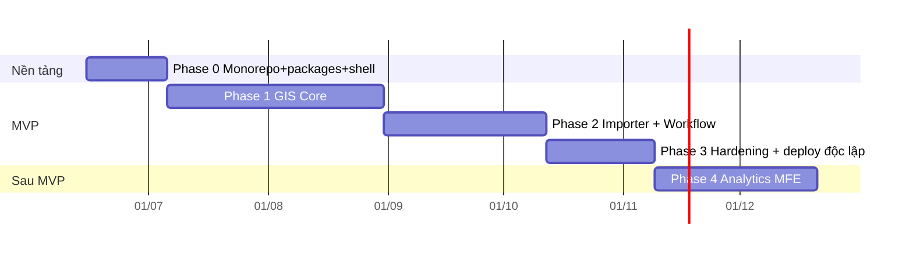

# water-network-fe — Thiết kế rewrite sang kiến trúc micro-frontend

- **Ngày**: 2026-06-15
- **Trạng thái**: Đã thống nhất định hướng, chờ review spec trước khi viết implementation plan
- **Phạm vi**: Frontend của nền tảng `water-network`. Backend (`water-network-gis-be`, DDD/CQRS/Event Sourcing) đã hoàn thành ở nơi khác — tài liệu này chỉ thiết kế FE.
- **Tham chiếu**: `deep-research-report.md` (cùng thư mục)

---

## 1. Bối cảnh & vấn đề

`water-network-gis-fe` (Solid.js) ban đầu được xây làm FE cho service GIS. Khám phá codebase cho thấy nó **kiến trúc tốt nhưng sai "hình dạng triển khai"**:

- Stack: Solid.js 1.9 + Vite 5 + TanStack Solid Query/Router + OpenLayers 10 + Keycloak 26 + Kobalte + Tailwind.
- Kiến trúc Feature-Slices Design chuẩn, có anti-corruption layer mạnh cho map (`MapEnginePort` + OL adapter), API theo port pattern (`GisQueryPort` + `GisWorkflowCommandPort`), 32 Zod contracts, 431 unit test + 95 E2E.
- Quy mô: ~1.183 file nguồn, ~160k dòng, 43 features, 18 pages.

**"Phình" đến từ 3 nguồn — không nguồn nào là kiến trúc sai:**

1. **Phình scope (lớn nhất)**: đã build nhiều thứ ngoài MVP — PM suite (4 trang), isolation trace, pressure-zone validator, upstream/downstream trace, directional topology graph, network health. Báo cáo xếp đây là post-MVP/conditional.
2. **Phình monolith**: là một SPA nguyên khối, chưa có module federation — ngược mục tiêu micro-frontend.
3. **Vài god-file**: `openlayers-adapter.ts` (2.327 dòng), `gis-viewer/index.tsx` (1.628), `gis-editor/index.tsx` (1.275); và một god-store gộp 8 concern.

## 2. Quyết định chiến lược (đã thống nhất)

| Quyết định | Lựa chọn | Ghi chú |
|---|---|---|
| Chiến lược | **Rewrite from scratch** trong `water-network-fe` | Viết mới nhưng chắt lọc tri thức thiết kế đã chứng minh từ gis-fe (không phát minh lại từ số 0) |
| Framework | **Solid.js + Vite** | Tận dụng tri thức đội, performance fine-grained hợp app bản đồ nặng |
| Repo & tích hợp | **Monorepo + Module Federation** (`@module-federation/vite`) | Shell host + remotes deploy độc lập |
| Monorepo tooling | **pnpm + Turborepo** | |
| Scope MVP | **4 MFE**: Shell, GIS Core (Viewer+Editor), Importer, Workflow+Reference | |
| Tính năng nâng cao | **Hoãn sang MFE `analytics` riêng** (phase sau) | Giữ code cũ làm tham khảo |
| Phương án tích hợp | **C — Hybrid** | Shell sở hữu singleton cross-cutting; map runtime là package chung nhưng mỗi MFE tự tạo instance; Viewer+Editor chung MFE → chia sẻ map tự nhiên |

**Nguyên tắc nền tảng của phương án C (Hybrid):** độc lập ở nơi rẻ (mỗi MFE tự chủ map instance + domain của nó), chia sẻ ở nơi đã chứng minh cần (auth, design system, contracts, query client). **Không chia sẻ live map instance xuyên MFE** — đây là nguồn coupling tệ nhất trong MFE bản đồ. Continuity Viewer↔Editor được giải bằng cách đặt cả hai trong cùng một MFE (GIS Core), không phải bằng shared live-map.

## 3. Kiến trúc tổng thể & Monorepo layout

```
water-network-fe/
├── pnpm-workspace.yaml
├── package.json                      # root scripts, dev orchestration
├── turbo.json                        # build/cache orchestration
├── apps/
│   ├── shell/                        # HOST — water-network-fe shell
│   │   └── src/{app.tsx, providers/, routes/, remotes/, config/}
│   ├── gis-core/                     # REMOTE — Viewer + Editor
│   ├── importer/                     # REMOTE — Spatial Importer
│   └── workflow/                     # REMOTE — Review/Approve/Publish + Reference
│       (analytics/  → phase sau)
├── packages/
│   ├── contracts/                    # @wn/contracts  — Zod schemas khớp API BE
│   ├── map-runtime/                  # @wn/map-runtime — MapEnginePort + OL adapter
│   ├── shared-ui/                    # @wn/ui — design system (Kobalte + Tailwind + CVA)
│   ├── platform/                     # @wn/platform — auth, http-client, query-keys, RBAC
│   ├── tsconfig/                     # config TS chung
│   └── eslint-config/                # ESLint boundary rules chung
└── e2e/                              # Playwright cross-MFE journeys
```

**Module Federation:**
- **Host = shell**: `remotes: { gisCore, importer, workflow }`, nạp động runtime.
- **Mỗi remote** `expose` một mount point (`./Routes`).
- **Shared singletons** (`singleton: true`, bắt buộc): `solid-js`, `@tanstack/solid-query`, `@wn/platform`, `@wn/ui`, `@wn/contracts`, `@wn/map-runtime`. Đây là điều kiện để Solid reactivity & một QueryClient hoạt động đúng xuyên remote.

```
                    ┌─────────────────────────────────────┐
   Keycloak ───────▶│  SHELL (host)                        │
                    │  auth ctx · QueryClient · router ·   │
                    │  theme · event bus · feature flags   │
                    └───┬──────────┬───────────┬───────────┘
        lazy import     │          │           │   (module federation)
                  ┌─────▼───┐ ┌────▼────┐ ┌────▼─────┐
                  │ gis-core│ │importer │ │ workflow │   ← remotes, deploy độc lập
                  └────┬────┘ └────┬────┘ └────┬─────┘
                       │ dùng chung (singletons)│
            ┌──────────┴──────────┬─────────────┴──────────┐
        @wn/map-runtime      @wn/contracts            @wn/ui · @wn/platform
        (mỗi MFE tự tạo      (hợp đồng Zod với BE)    (design system, auth, http)
         instance riêng)
```

**Quan hệ với BE:** mỗi MFE gọi REST `…/api/water-network-gis/v1/*` qua `@wn/platform` http-client + `@wn/contracts`. Token JWT từ Keycloak do shell quản lý, inject vào mọi request. Không FE nào tự xây IAM/audit.

## 4. Thiết kế shared packages

Phụ thuộc một chiều, không vòng:
```
apps → @wn/platform, @wn/map-runtime, @wn/ui → @wn/contracts (đáy, không phụ thuộc ai)
```

### `@wn/contracts` — Hợp đồng dữ liệu với BE
- Nguồn chân lý duy nhất về shape API: Zod schemas + type suy ra, khớp 1-1 với REST endpoints/DTO của BE.
- Tổ chức theo **bounded context của BE** (không theo MFE): `snapshot/`, `revision/`, `import/`, `workflow/`, `binding/`, `common/`.
- Chỉ schema + type thuần; không fetch, không phụ thuộc solid/ol. Versioned `v1`. Mỗi schema có test round-trip parse + contract test khớp sample payload BE.
- Chắt lọc: 32 contract cũ là điểm khởi đầu; tổ chức lại theo bounded context, loại contract của tính năng nâng cao.

### `@wn/map-runtime` — Map engine + anti-corruption layer
- Bọc OpenLayers sau `MapEnginePort`. Giữ triết lý port (tài sản giá trị nhất của code cũ), **chẻ god-file**:
```
map-runtime/src/
  port/                 # MapEnginePort interface (zero ol types lọt ra)
  openlayers/
    lifecycle-adapter   # init map/view/projection (proj4, VN-2000)
    layer-adapter       # tile/vector/WebGL, plane management
    draw-modify-adapter # edit interactions
    snap-adapter
    style-adapter
    picker-adapter      # hit-test / selection
  factory.ts            # createMapInstance() → MapEnginePort (mỗi MFE tự gọi)
  solid/                # useMapRuntime() — Solid integration + lazy-load OL chunk
```
- Chỉ file trong `openlayers/` được import `ol/*` (ESLint chặn nơi khác). Lazy-load OL + proj4 vào chunk riêng.

### `@wn/ui` — Design system
- Component library thật (cái code cũ thiếu): Kobalte headless + Tailwind + CVA + Lucide.
- `primitives/` (button, dialog, dropdown, toast, tooltip…), `patterns/` (panel, dock, sidebar, data-table, status-bar), `theme/` (tokens, light/dark, enhanced-contrast), `icons/`.
- Thuần presentational; không biết domain GIS, không fetch. Dùng mockup `water-network-gis-ui` (React) làm đặc tả thị giác để dựng lại bằng Solid.

### `@wn/platform` — Hạ tầng cross-cutting
```
platform/src/
  auth/      # Keycloak wrapper, IUserContext (sub, roles, tenant?), token refresh
  http/      # http-client (Bearer inject, retry, error→envelope) + ports:
             #   GisQueryPort, GisWorkflowCommandPort
  query/     # QueryClient factory, query-keys factory
  rbac/      # role→capability (Viewer/Editor/Importer/Review/Approve/Publish)
  events/    # event bus (mitt) typed
  config/    # runtime config, feature flags
```
- Adapter pattern: mock adapter (dev/test) + real adapter (prod). RBAC map đúng claim Keycloak (`realm_access.roles` + `resource_access`).

## 5. Cấu trúc nội bộ từng MFE

Mỗi MFE là app Solid + Vite (remote), theo FSD rút gọn. Khung chung:
```
apps/<mfe>/src/
  routes/        # subtree route (TanStack Router)
  features/      # feature slices (UI + model + lib)
  widgets/       # composite UI riêng
  entities/      # domain model riêng (nếu cần ngoài @wn/contracts)
  bootstrap.tsx  # standalone dev entry (mock host context → chạy độc lập)
  expose.tsx     # mount point cho shell (nhận auth/query/config từ host)
```
Mỗi MFE **chạy độc lập** (`bootstrap.tsx`) để phát triển/test riêng; và mount vào shell (`expose.tsx`) dùng singleton thật từ host.

### `apps/gis-core` — Viewer + Editor (trọng tâm)
Viewer + Editor chung MFE → chia sẻ một map instance tự nhiên (bảo toàn continuity: viewport, selection, layer/filter, active draft).
```
gis-core/src/
  routes/{viewer.tsx (/gis), editor.tsx (/gis/editor)}
  features/
    map-canvas/         # tạo & sở hữu map instance (từ @wn/map-runtime factory)
    feature-selection/  # linked selection, detail, related (1-hop)
    layer-control/      # layer/filter/basemap
    feature-search/
    digitize/           # tạo pipe/node/facility/component
    topology-edit/      # snap/split/connect/classify-crossing
    attribute-edit/     # technical attributes, bulk edit
    asset-binding/      # NetworkAssetPlacement, bind external asset
    spatial-lease/      # acquire/renew/release lease (backend-authoritative)
    draft-validation/   # run validation + evidence (blocking/non-blocking)
    draft-submit/
  widgets/{map-shell/, properties-palette/, context-sidebar/}
```
- Map state tách concern (sửa god-store cũ): `viewport-store`, `selection-store`, `layer-store`, `draft-store`.
- Viewer↔Editor chuyển nhau **không unmount map** (giữ instance), chỉ đổi mode + bật/tắt edit interaction.

### `apps/importer` — Spatial Importer
```
importer/src/
  routes/{upload (/import), staging (/import/:batchId/staging), validation}
  features/
    file-upload/        # GeoJSON/KML/DXF, perimeter + actual-type check
    parse-status/       # poll batch parse (202 async, worker BE)
    staging-preview/    # map instance RIÊNG (từ @wn/map-runtime)
    feature-mapping/    # map staged feature → catalog MVP
    import-validation/
    provenance-view/    # file metadata, checksum, CRS, parser version
    batch-submit/
  widgets/{staging-report/, mini-map/}
```
Importer có map instance riêng (không đụng map gis-core). Parse async: tạo batch trả `202`, FE poll status.

### `apps/workflow` — Review/Approve/Publish + Reference
```
workflow/src/
  routes/{review-queue, approval-queue, work-item (/workflow/items/:id),
          lineage (/workflow/lineage/:type/:id)}
  features/
    review-queue/, work-item-detail/ (diff + evidence panels),
    review-decision/, approve-reject/, publish/,
    decision-history/, lineage-explorer/   # Reference gộp vào đây
```
Không cần map nặng (read-only preview nhỏ khi xem diff nếu cần, dùng factory chung).

### Shell nạp remote
- Route cha ở shell: `/gis/*` → `gisCore/Routes`, `/import/*` → `importer/Routes`, `/workflow/*` → `workflow/Routes`.
- `expose.tsx` mỗi remote nhận từ host: `userContext`, `queryClient`, `eventBus`, `config` (context provider của `@wn/platform`, singleton).
- Route guard RBAC ở shell. Deep-link giữ format cũ (`?featureId=…`, `?snapshotId=…`).

## 6. Cross-cutting

### 6.1 Auth & token flow (Keycloak, shell-owned)
- Một chỗ duy nhất nói chuyện Keycloak: shell. `@wn/platform/auth` init Keycloak, giữ token + auto-refresh, dựng `IUserContext { userId(sub), userName, email, roles, tenantId? }` làm provider singleton.
- Remote đọc cùng `IUserContext`, không tự init IAM. http-client tự inject Bearer; 401→refresh→retry.
- RBAC map claim Keycloak → capability `Viewer/Editor/Importer/Review/Approve/Publish`.
- **Cần chốt với team IAM** (báo cáo đánh dấu "không xác định"): tên claim tenant (`tenant_id`/`org_id`) → đưa vào runtime config, không hardcode.
- Dev mode: mock auth (chọn role) giữ lại như code cũ.

### 6.2 Routing (2 tầng)
- Shell sở hữu route cha + route guard RBAC (chặn trước khi nạp remote → không tải JS thừa).
- Mỗi remote sở hữu route con (lazy code-split). Deep-link tương thích ngược.

### 6.3 Data-flow (port pattern, CQRS-aligned)
```
Component → useQuery/useMutation (QueryClient singleton)
  → GisQueryPort / GisWorkflowCommandPort (@wn/platform)
    → prod adapter → http-client → /api/water-network-gis/v1/* → BE
    └ mock adapter → fixtures (dev/test/standalone)
  → Zod parse (@wn/contracts) → DTO→domain → store/signal → render
```
- **Query** (GET): snapshot, map-features theo bbox, detail, related, lineage, queue. Cache/invalidate qua `query-keys` factory.
- **Command** (POST/PUT/DELETE theo business intent): create pipe, snap/split, bind asset, lease, submit/review/approve/publish. Mang `expectedStreamVersion`/ETag (optimistic concurrency BE yêu cầu) + `correlationId`.

### 6.4 State management (3 tầng rạch ròi)
| Loại | Công cụ | Phạm vi |
|---|---|---|
| Server state | TanStack Solid Query (QueryClient singleton ở shell) | xuyên MFE |
| Client/UI state | Solid signals + stores tách concern nhỏ | trong từng MFE |
| Cross-MFE state | event bus typed + URL params | giữa shell↔remote |

Cross-MFE giao tiếp qua event bus + URL, **không** share live store object xuyên remote.

### 6.5 Lease & realtime
- Lease là REST command, BE là nguồn chân lý. Realtime lock (WebSocket/SignalR, optional) chỉ gợi ý UI. MVP polling, nâng cấp WS sau.

### 6.6 Error handling & resilience
```
http-client → error envelope (@wn/contracts/common)
  401 → refresh→retry; fail → shell login
  403 → toast thiếu quyền + RBAC guard
  409 → prompt reload/rebase draft (version conflict)
  422 → map vào validation evidence panel
  5xx → retry backoff + Sentry
ErrorBoundary 2 tầng: shell (toàn cục) + mỗi remote (cô lập lỗi 1 MFE)
```
Một remote lỗi → shell hiện fallback vùng đó, các MFE khác vẫn sống. Telemetry: Sentry + web-vitals ở shell, mỗi MFE tag riêng.

## 7. Kỷ luật chống phình (enforce trong CI)

**(a) Chống phình scope** — nguồn phình lớn nhất:
- `SCOPE.md` per MFE liệt kê feature được phép; PR ngoài danh sách bị chặn.
- Tính năng nâng cao không có chỗ trong 4 MFE MVP → chỉ vào `analytics` phase sau.
- Mọi feature map tới một FR trong PRD/báo cáo; YAGNI cho phần không rõ nguồn.

**(b) Chống phình cấu trúc** — god-file/god-store:
- ESLint boundary (`eslint-plugin-boundaries`): app không import nội bộ app khác; feature không import feature khác (chỉ qua widget chung/`@wn/*`); chỉ `@wn/map-runtime/openlayers/*` import `ol/*`; `@wn/contracts` không import package khác.
- Ngưỡng kích thước file: CI warning >400 dòng, fail >600 (trừ test/fixture/generated).
- Store một-concern: cấm gộp >1 domain.

**(c) Chống phình bundle:**
- `size-limit` budget per chunk (kế thừa cấu hình cũ): entry shell ≤120KB, map-engine ≤200KB, importer-parsers ≤80KB, export ≤150KB.
- Lazy-load OL+proj4, dxf-parser, jsPDF/XLSX.

## 8. Testing strategy

| Tầng | Công cụ | Mục tiêu |
|---|---|---|
| Unit | Vitest | transformers, rbac, port adapters, store, formatters |
| Contract | Vitest + Zod | round-trip parse + khớp sample payload BE |
| Component | Vitest + Solid Testing Library | feature UI với mock adapter |
| Integration MFE | Vitest | mỗi MFE standalone (bootstrap.tsx) + mock adapter |
| MF integration | Playwright | shell nạp remote thật, route guard, error isolation |
| E2E journey | Playwright | viewer↔editor continuity, import valid/invalid, review→approve→publish |
| A11y | axe + Playwright | WCAG cho viewer/editor (tablet/keyboard) |

- Fixture dùng builder/factory pattern chung trong `@wn/contracts/testing` (sửa fixture phình cũ ~680 dòng). Mock adapter chia sẻ một bộ fixture nhất quán.
- **Definition of Done** mỗi feature: trong scope, qua ESLint boundary + size gate, có unit + component test với mock adapter, khớp contract test, MFE vẫn chạy standalone, không file >600 dòng.

**Tài liệu sống**: `ADR/` ở root (giữ Solid, MF hybrid C, map instance per-MFE, defer analytics…), `SCOPE.md` per MFE, `CONTRACTS.md` map endpoint BE ↔ schema FE.

## 9. Roadmap theo phase

Giả định sprint 2 tuần, một squad FE; điều chỉnh theo nhân lực thực tế.

### Phase 0 — Nền tảng (≈2–3 tuần, bắt buộc trước)
Monorepo (pnpm+Turborepo, tsconfig/eslint chung, boundary rules, size-limit, CI); `@wn/contracts`; `@wn/platform`; `@wn/ui` (core); `@wn/map-runtime`; `apps/shell` (host MF, router, auth, guard, error boundary).
**Mốc xong**: shell nạp được một remote "hello" với singleton (Solid + Query) hoạt động đúng — xác minh rủi ro MF+Solid sớm.

### Phase 1 — GIS Core (≈6–8 tuần, trọng tâm, rủi ro cao nhất)
map-canvas, viewer (snapshot/map-features/detail/related/search/lineage), editor (digitize/topology/attribute/binding/lease/validation/submit), continuity, store tách concern, deep-link.
**Mốc xong**: E2E continuity pass; tạo→validate→submit revision chạy thật với BE.

### Phase 2 — Importer + Workflow (≈6 tuần, song song nếu đủ người)
Importer (upload/parse/staging/mapping/validation/provenance/submit); Workflow (review/approval queue, work-item detail, review/approve/reject/publish, decision-history, lineage).
**Mốc xong**: E2E import valid/invalid + review→approve→publish sinh snapshot.

### Phase 3 — Hardening & độc lập hóa (≈4 tuần)
Performance gate (~50k feature, bbox latency), deploy độc lập từng remote (CI/CD per remote), canary qua gateway, A11y, telemetry, quyết định BFF (mặc định chưa cần).

### Phase 4 (sau MVP) — `analytics` MFE
Port chọn lọc tính năng nâng cao đã hoãn (PM suite, isolation/pressure/trace, topology graph, network health) vào MFE riêng + contracts riêng — không đụng GIS Core.



## 10. Rủi ro & giảm thiểu

| Rủi ro | Mức | Giảm thiểu |
|---|---|---|
| Module Federation + Solid singleton (reactivity xuyên remote) | Cao | Spike "hello remote" ngay Phase 0 trước khi build feature |
| Map continuity Viewer↔Editor | Cao | Giữ Viewer+Editor chung một MFE; không unmount map khi đổi mode |
| Phình lại scope | Trung bình | Lan can CI (scope gate, boundary, size) từ Phase 0 |
| Lệch hợp đồng với BE | Trung bình | Contract test khớp sample payload BE ngay Phase 0 |
| Tên claim tenant chưa xác định | Thấp | Đưa vào runtime config; chốt với team IAM trước khi đóng spec chi tiết |

## 11. Điểm cần chốt thêm (open questions)

- Tên claim tenant trong token Keycloak (`tenant_id`/`org_id`?) — chốt với team IAM/platform.
- Canonical CRS của `PublishedNetworkSnapshot` — runtime config, không hardcode.
- Có cổng API Gateway đứng trước BE không, và FE gọi thẳng BE hay qua gateway — ảnh hưởng base URL/CORS.
- Nhân lực squad FE thực tế — ảnh hưởng việc Phase 2 có chạy song song được không.
